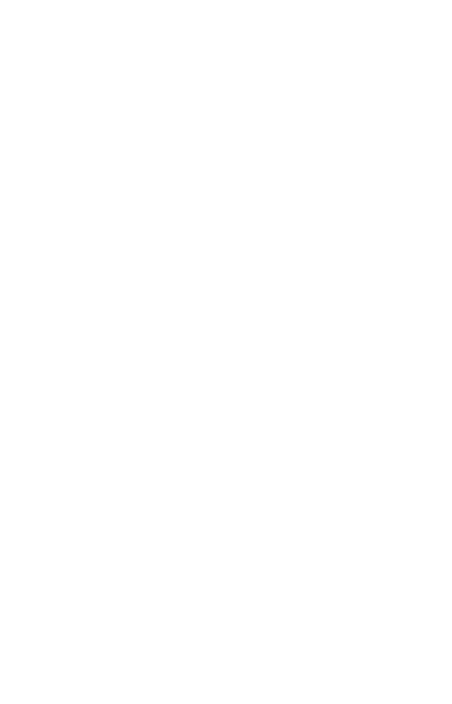
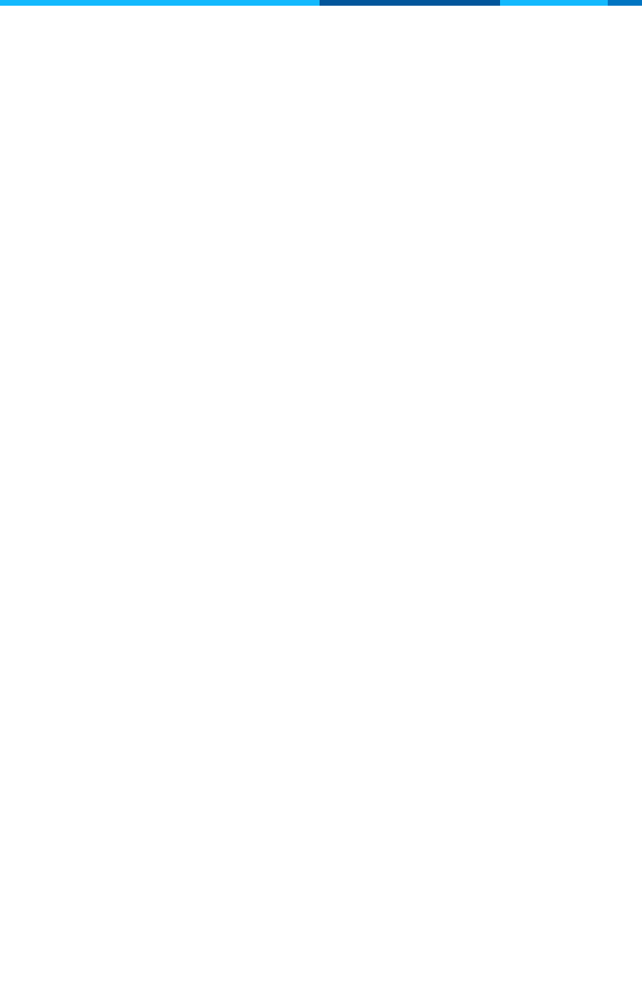

# cv_flutter_sarah

Application mobile Flutter présentant le CV, la famille et les coordonnées de **Tshirezi Lwaboshi Sarah**.

## Fonctionnalités

- Page de connexion avec identifiant et mot de passe masqué
- CV complet : photo, profil, formation, expériences, compétences, langues et centres d’intérêt
- Page Famille avec carte pour chaque membre
- Page Contact avec téléphone, e-mail, adresse et réseaux sociaux
- Navigation par BottomNavigationBar et Drawer

## Captures d’écran

### Page de connexion



### Accueil — CV


### Famille



### Contact


## Lancer le projet

```bash
flutter pub get
flutter run
```
